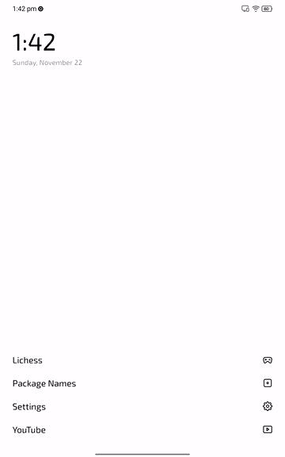

# Kanso Launcher

An ultra-minimalist, fast, and distraction-free Android launcher built with Jetpack Compose.

 

---

## Features

- **Distraction-Free Experience**: Text-based interface with custom minimal outline icons.
- **Inertial Wheel Scrolling**: Weighted, fluid momentum physics that move smoothly even on low-tier hardware.
- **Custom App Icons**: Long-press any pinned app to select from 25 minimalist outline icons, or let it auto-detect.
- **Quick Drawer & Search**: Swipe up to search through all installed apps instantly.
- **Smart Launch**: Optional auto-open keyboard on drawer open and auto-launch when a search matches a single app.
- **Pure Black AMOLED Dark Mode**: True `#000000` dark theme for maximum OLED battery savings.
- **100% Private**: No internet permissions, no trackers, no telemetry, and zero third-party dependencies.

---

## Download

Get the latest release APK from the [Releases](https://github.com/capycdr786/KansoLauncher/releases/latest) page.

---

## License

This project is licensed under the [GNU General Public License v3.0](LICENSE).
